<!-- HEADER BANNER -->

  

<!-- ANIMATED TYPING & SOCIAL LINKS -->

  

  

    
    
    
    
    
  

## 👨‍💻 About Me

<table>
  <tr>
    <td width="65%" valign="center">
      <pre>
raj@developer:~$ whoami
> Raj Pagare — Software Engineer & Backend Specialist

raj@developer:~$ cat profile.json
{
  "education": "B.Tech CSE @ Acropolis Institute of Technology & Research",
  "graduation": 2027,
  "core_focus": ["Java Backend", "Microservices", "System Design", "DSA"],
  "philosophy": "Write clean code, design fault-tolerant architectures, and never stop shipping."
}
      </pre>
    </td>
    <td width="35%" align="center" valign="center">
      
    </td>
  </tr>
</table>

## 🛠️ Tech Stack & Ecosystem

  <table>
    <tr>
      <td align="center" width="20%"><b>💻 Languages</b></td>
      <td align="center" width="20%"><b>⚙️ Backend</b></td>
      <td align="center" width="20%"><b>🗄️ Databases</b></td>
      <td align="center" width="20%"><b>🎨 Frontend</b></td>
      <td align="center" width="20%"><b>🚀 DevOps & Tools</b></td>
    </tr>
    <tr>
      <td align="center">
         
        Java • C++ • Python • C • SQL
      </td>
      <td align="center">
         
        Spring Boot • Security • JPA • RabbitMQ
      </td>
      <td align="center">
         
        PostgreSQL • MySQL • MongoDB • Redis
      </td>
      <td align="center">
         
        React • TypeScript • JS • HTML5/CSS3
      </td>
      <td align="center">
         
        Docker • AWS S3 • Git • JUnit • IntelliJ
      </td>
    </tr>
  </table>

## 🚀 Featured Projects Showcase

  <table>
    <tr>
      <td width="50%" valign="top">
        <h3>🧠 <a href="https://github.com/rajpagare01/ForgeAI">ForgeAI</a></h3>
        
<b>AI-Native Engineering Intelligence Platform</b>

        
Connects requirements, tasks, GitHub activity, testing, and AI analysis into a single traceable workflow using a microservices architecture communicating via RabbitMQ.

        

          
          
          
          
          
        

        
      </td>
      <td width="50%" valign="top">
        <h3>🏫 <a href="https://github.com/rajpagare01/Campus-sync">CampusSync</a></h3>
        
<b>Full-Stack Campus Social Platform</b>

        
Enables students to manage campus events, posts, and communities seamlessly with Role-Based Access Control (RBAC) and full CRUD operations.

        

          
          
          
          
        

        
        
      </td>
    </tr>
    <tr>
      <td width="50%" valign="top">
        <h3>⚡ <a href="https://github.com/rajpagare01/DevCommand">DevCommand</a></h3>
        
<b>Personal Developer Command Center</b>

        
Centralized productivity hub to manage DSA progress, job applications, learning roadmaps, daily tasks, and technical interview preparation.

        

          
          
          
          
          
        

        
      </td>
      <td width="50%" valign="top">
        <h3>🛡️ <a href="https://github.com/rajpagare01/JobShield">JobShield</a></h3>
        
<b>Job Application Management Platform</b>

        
Streamlines tracking, analytics, and stage management of job applications with secure backend authentication and containerized deployment.

        

          
          
          
          
          
        

        
      </td>
    </tr>
    <tr>
      <td width="50%" valign="top">
        <h3>🚨 <a href="https://github.com/rajpagare01/SafeRoute">SafeRoute</a></h3>
        
<b>Women Safety & Emergency Tracking System</b>

        
Real-time safety ecosystem featuring an instant SOS trigger, live location tracking, automated alerts, admin analytics, and AI-based unsafe-zone prediction.

        

          
          
          
          
        

        
      </td>
      <td width="50%" valign="top">
        <h3>⚖️ <a href="https://github.com/rajpagare01/SamvidhanSetu">Samvidhan Setu</a></h3>
        
<b>Interactive Constitution of India Platform</b>

        
Educational web platform designed to make the articles, schedules, and amendments of the Indian Constitution interactive and accessible.

        

          
          
          
          
        

        
      </td>
    </tr>
  </table>

  

    
<b>📂 View Mini-Projects & Foundation Clones</b>

     
    

      <code>🏦 Bank Management System</code> • 
      <code>🚌 Bus Booking System</code> • 
      <code>🧱 Brick Breaker Game</code> • 
      <code>▶️ YouTube Frontend Clone</code> • 
      <code>🍔 Swiggy Frontend Clone</code>
    

  

## 🎯 Current Focus & Problem Solving

  <table>
    <tr>
      <td valign="top" width="50%">
        <h3>📚 Architecture & Deep Dives</h3>
        <ul>
          <li>Advanced <b>Spring Boot</b>, <b>Spring Security</b> & Microservices</li>
          <li><b>System Design</b> (Scalability, Caching, Load Balancing, Message Queues)</li>
          <li><b>REST API</b> design patterns, performance tuning & containerization</li>
          <li>Database optimization with <b>PostgreSQL</b>, <b>Redis</b> & <b>Docker</b></li>
        </ul>
         
        <h4>🧠 Core DSA Topics</h4>
        

          <code>Arrays & Strings</code> <code>Custom HashMaps</code> <code>Monotonic Stacks</code> <code>Priority Queues</code> <code>Trees & BSTs</code> <code>Graphs (BFS/DFS/Dijkstra)</code> <code>Dynamic Programming</code>
        

      </td>
      <td valign="center" align="center" width="50%">
        <h3>⚡ LeetCode Problem Solving</h3>
        <!-- LIVE LEETCODE CARD (Change username if different from rajpagare01) -->
        
      </td>
    </tr>
  </table>

## 📈 GitHub Statistics & Activity

  <!-- GITHUB TROPHIES -->
  
    

  <!-- STATS & STREAK CARDS -->
  
  
    

  <!-- ANIMATED CONTRIBUTION SNAKE -->
  <picture>
    <source media="(prefers-color-scheme: dark)" srcset="https://raw.githubusercontent.com/rajpagare01/rajpagare01/output/github-contribution-grid-snake-dark.svg" />
    <source media="(prefers-color-scheme: light)" srcset="https://raw.githubusercontent.com/rajpagare01/rajpagare01/output/github-contribution-grid-snake.svg" />
    
  </picture>
    

  <!-- CONTRIBUTION GRAPH (ANIMATED LOOP) -->
  <picture>
    <source srcset="https://raw.githubusercontent.com/rajpagare01/rajpagare01/output/activity-graph.svg" />
    
  </picture>

<!-- FOOTER BANNER -->

  

